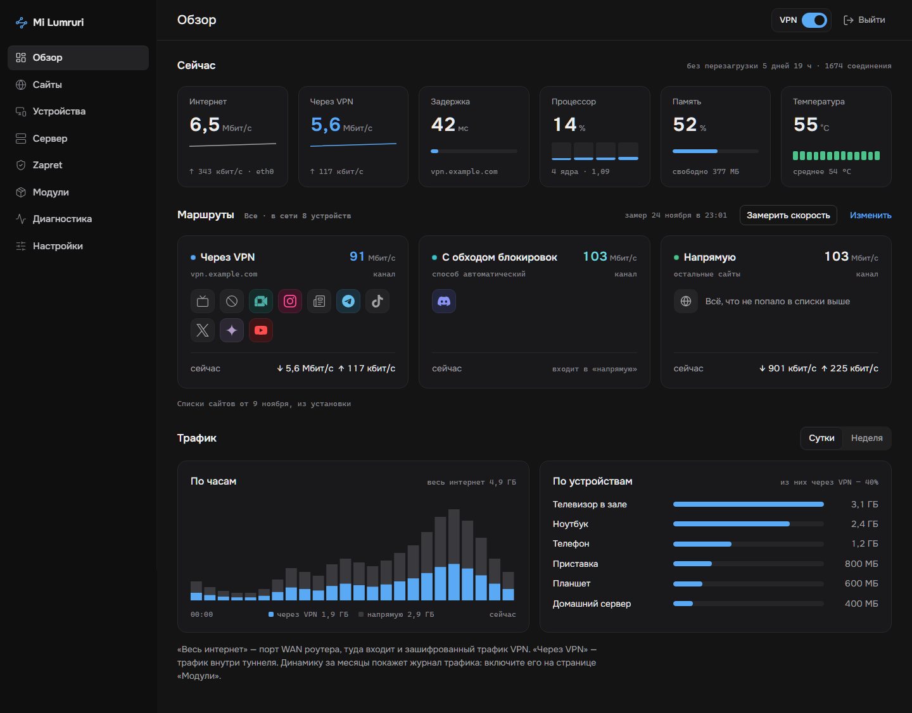
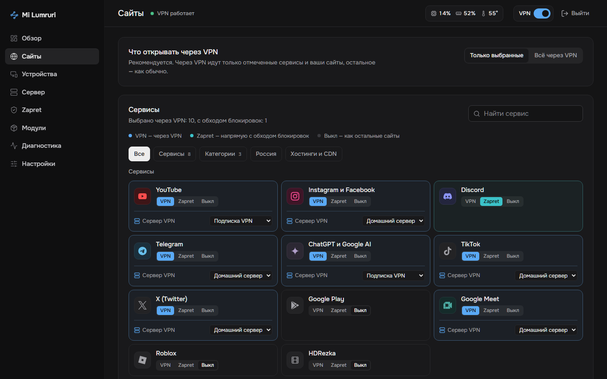
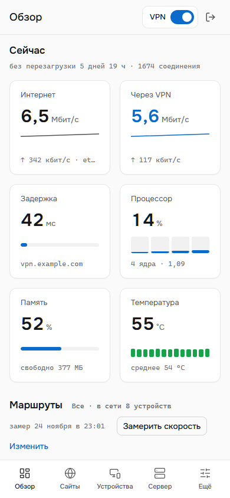
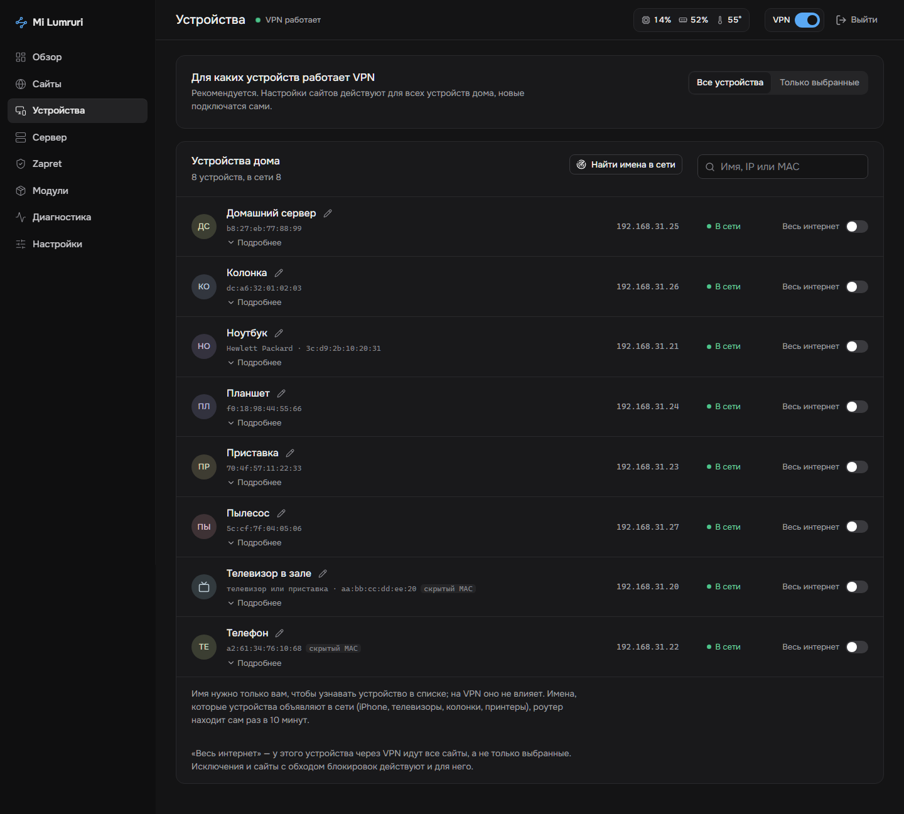
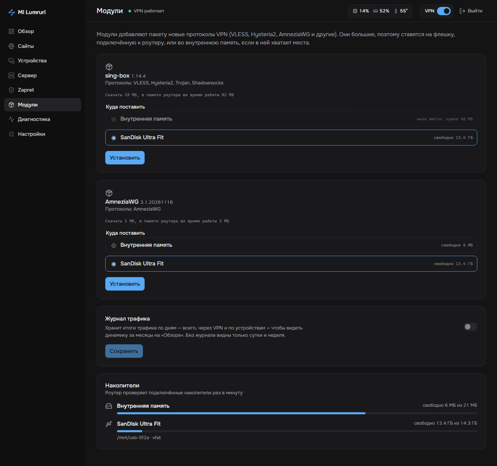
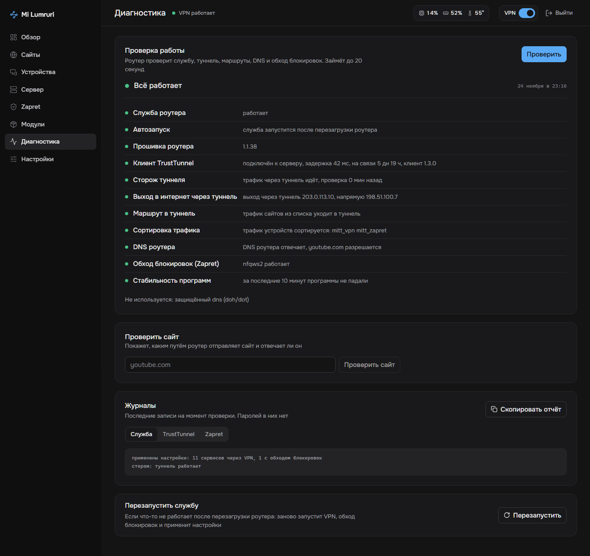
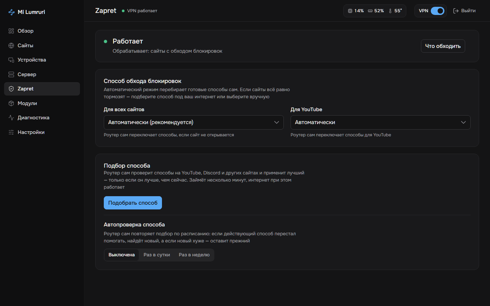
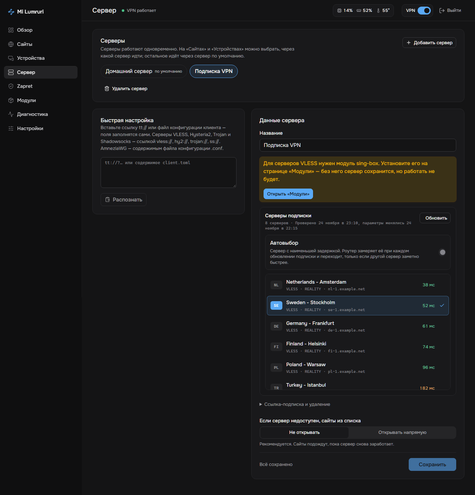

# Mi Lumruri

[Русский](README.md) · **English** · [简体中文](README.zh-CN.md)

Selective VPN and DPI bypass for the Xiaomi BE7000 on stock firmware. Paste a server link and pick services: YouTube, Instagram and ChatGPT go through the VPN, Discord goes direct with Zapret DPI bypass, everything else works as usual. [TrustTunnel](https://github.com/TrustTunnel) is built in; VLESS, Hysteria2, Trojan, Shadowsocks and AmneziaWG come as modules on a USB drive. Several servers run at the same time.



**Router:** Xiaomi BE7000 (RC06), firmware 1.1.38. No reflashing: the package is installed over SSH into internal storage (about 4.5 MB) and runs on the stock iptables, ipset and dnsmasq.

**[Install and set up](docs/guide.en.md)** · [Update or roll back](docs/guide.en.md#updating-and-rollback) · [Limitations](docs/guide.en.md#limitations) · [Uninstall](docs/guide.en.md#uninstalling) · [Build the package](docs/build.md) (in Russian)

## Install

Download three files from the [latest release](https://github.com/NooBiToo/mi-lumruri/releases/latest) into one folder: `mi-lumruri-*.tar`, `SHA256SUMS` and `install.py`. In that folder run:

```sh
python install.py 192.168.31.1
```

You need Python 3.8+, an OpenSSH client and root SSH access to the router ([how to get it](docs/guide.en.md#ssh-access-before-installation)). The installer asks for the root password and sets the panel password. The panel is at `https://192.168.31.1:8443/`.

The router's internal storage is small: about 20 MB, of which the firmware uses about 9 MB. If space is tight, the installer installs the new version without keeping the previous one and warns that rollback will not be available.

## Features

| | |
| --- | --- |
| **Servers** | Paste a link and the fields fill in. **TrustTunnel** is built in: the official `trusttunnel_client` v1.3.0, HTTP/2 or HTTP/3, anti-DPI, TLS profile, client_random, subscription link. **VLESS** (TCP, WebSocket, gRPC, Reality, xtls-rprx-vision), **Hysteria2**, **Trojan** and **Shadowsocks** through the sing-box module, with `https://` subscriptions that list servers to pick from. **AmneziaWG** 1.x and 2.0 through the amneziawg module, from a `.conf` file. Up to 16 servers **at the same time**: a service on Sites and a device can each use their own. Subscription servers in a list with the latency to each and auto select of the fastest. A TrustTunnel backup server with failover and return, and switching to the server with lower latency. If a server is down, listed sites either wait or open directly, your choice. |
| **Sites** | Each service is **VPN**, **Zapret** or **Off**. Ready-made [itdoginfo/allow-domains](https://github.com/itdoginfo/allow-domains) lists with service subnets ship with the package and update themselves: from every 6 hours to once a week, or manually only. Your own VPN sites, DPI-bypass sites and exceptions are separate lists. There is an "Everything through VPN except exceptions" mode and IPv6 through the VPN. |
| **Zapret** | nfqws2 from zapret2 with ready strategies works out of the box. "Find a method" tests strategies on the router and applies the best one only if sites open better than without Zapret. The method can also be picked manually, separately for YouTube. Scheduled method re-checks. |
| **Devices** | All home devices or only selected ones. Names: yours, announced on the network (iPhone, Chromecast, TVs, speakers), from DHCP, or the maker by MAC. A "hidden MAC" mark, details with connection type and traffic. A single device can get "All internet" through the VPN and its own server. |
| **DNS** | Secure DNS (DoH or DoT) for all other sites: Cloudflare, Google, AdGuard, NextDNS, Quad9 or your own server. For VPN sites, DNS inside the tunnel, optionally encrypted. Custom DNS records: a domain with all subdomains points to an address on the home network. Ad blocking: HaGeZi Light, Normal or your own list. |
| **Overview** | Now tiles refreshed every 5 seconds: internet and VPN speed with a chart, latency to the server, CPU per core, memory, temperature per sensor. Route cards with the measured channel speed and current traffic. Traffic for a day and a week by hour and by device; with the log on a USB drive also for a month, 3 months and a year (the log keeps 1 to 24 months). Speed and latency test from the router. |
| **Modules** | Large programs go to a USB drive, or to internal storage when there is room: sing-box and AmneziaWG. The router downloads a module from GitHub and checks SHA-256 and the signature. The Drives card shows storage and USB drives; if the drive is removed you get a notification, and the module starts again by itself when it is back. |
| **Notifications** | Telegram: tunnel down or back up, the watchdog restarted the client, switch to the backup server, a new version, an update installed or rolled back, a subscription failed to update, the router booted. Messages wait in a queue while there is no connection. |
| **Diagnostics** | One-button check: service, autostart, firmware, server connection and client version, internet through the tunnel, tunnel watchdog, routes, DNS, Zapret and programs stuck in a restart loop. Single-site check: which path it takes and whether it opens. Logs and a report in one click, service restart. |
| **Updates** | From the panel: the router downloads a new release from GitHub, checks SHA-256 and the signature, installs it and watches for 5 minutes that everything works; if not, it rolls back by itself. New version check once a day or a week. Settings backup to a file, server passwords optional and encrypted with the backup password. |
| **Panel** | HTTPS and a password, optionally a second step with an app code (TOTP). Russian, English and Simplified Chinese. Works on your own domain and behind a reverse proxy. Changes save themselves, and the panel is easy to use from a phone. |

<p>
  
  
</p>

<p>
  
  
</p>



<p>
  
  
</p>

## How it works

1. dnsmasq adds the addresses of listed domains to ipset sets.
2. Using these sets, iptables marks traffic from the selected devices:
   - marked traffic goes to the TUN interface of its server's client (TrustTunnel, sing-box or amneziawg-go; each server has its own tunnel and mark);
   - sites with DPI bypass pass through nfqws2;
   - everything else goes direct.
3. The router resolves VPN-site domains with a DNS server inside the tunnel, so the ISP cannot see or tamper with the answers. Other domains go through the secure DNS of the `mi-tt-dns` program, if enabled.
4. A Rust controller reconciles the rules with the kernel and restores them after a firewall reload.

Details are in the [architecture document](ARCHITECTURE.md) (in Russian).

## Status

The package runs on the BE7000 with firmware 1.1.38: tunnel, selective routing, Zapret, secure DNS, several servers at once, the sing-box module and the panel. New features are tested first in a network lab with the stock firmware components, then on the router. Please report problems in [Issues](https://github.com/NooBiToo/mi-lumruri/issues).

- Listed sites are matched by IPv4 only: devices with VPN or Zapret rules have no outbound IPv6. The exception is devices whose whole internet goes through the VPN, with "IPv6 via VPN" turned on: their IPv6 goes through the tunnel, and the VPN server needs IPv6. Preset DNS servers have IPv6 addresses, but they are used only as a fallback.
- Sites are matched by DNS: a device must use the router as its DNS server. "Secure DNS" (DoH) in a browser bypasses the lists.
- Several servers at once use the mark bits of the UU plugin (a game booster) or, if it is on, of the backup WAN. If both are on, one server works. The backup server replaces the main one, and switching takes up to 2 minutes.
- VLESS, Hysteria2, Trojan and Shadowsocks servers work through the sing-box module on a USB drive or in internal memory; AmneziaWG servers work through the amneziawg module.
- DoT does not work everywhere: many ISPs block port 853.

The full list is in the [guide](docs/guide.en.md#limitations).

## For developers

The project used to be called mi-trusttunnel. Since version 0.5.0 the package and the folders on the router are named `mi-lumruri` (`/data/mi-lumruri`, `/tmp/mi-lumruri`). Installing the new version over 0.4 moves `/data/mi-trusttunnel` to `/data/mi-lumruri` together with settings, passwords and keys, and leaves a link in the old place, so rolling back to 0.4 and old commands keep working. The programs inside the package are still called `mi-tt-*`.

- The controller, the admin utility and the DNS proxy are written in Rust and built into a single program, `mi-tt`.
- The panel uses Vue 3, TypeScript and PrimeVue.
- On the router it uses the stock nginx, uhttpd, dnsmasq, iptables and ipset. Node.js is only needed on the build machine.
- Changes are tested in a network lab built from stock firmware components.

[Build and tests](docs/build.md) · [Architecture](ARCHITECTURE.md) · [Stage log](VERTICAL-SLICE.md) (all in Russian)

A similar project for OpenWrt: [TrustTunnelOpenWrt](https://github.com/NooBiToo/TrustTunnelOpenWrt). Component licenses are listed in [NOTICE](NOTICE).
