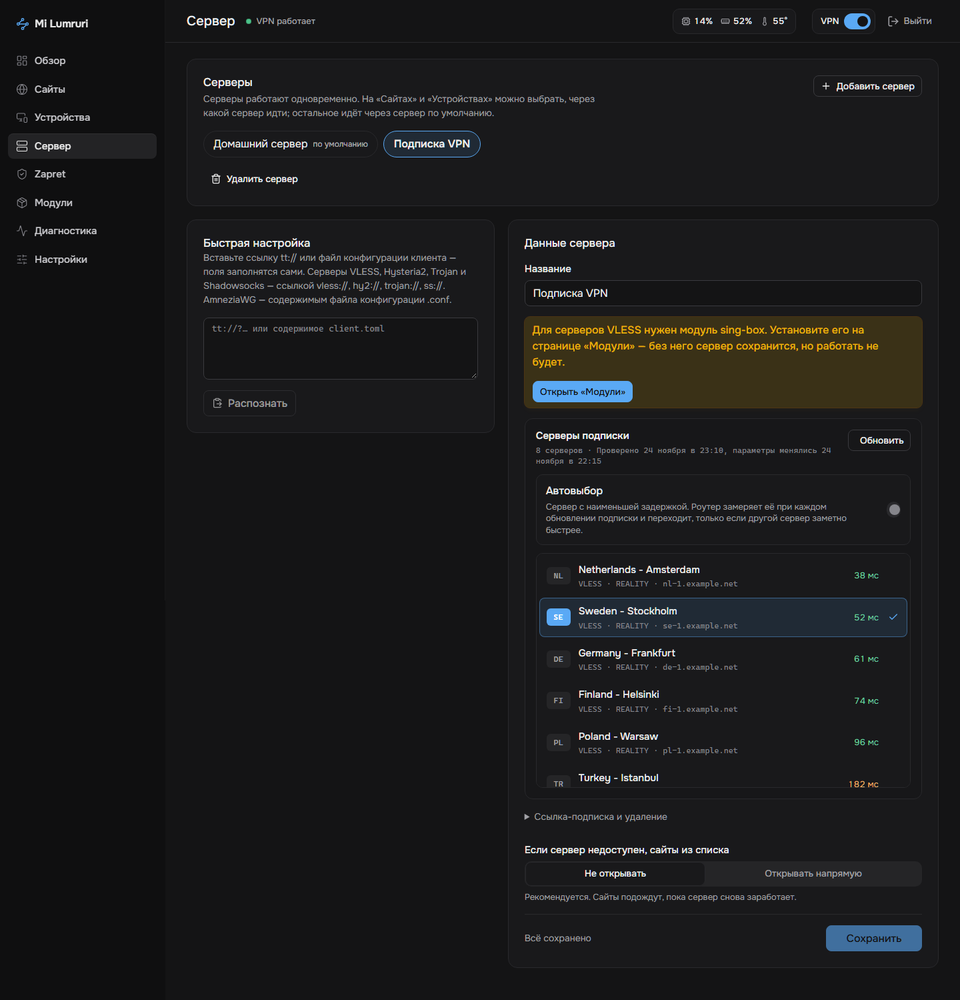

# Mi Lumruri

**Русский** · [English](README.en.md) · [简体中文](README.zh-CN.md)

Выборочный VPN и обход блокировок для Xiaomi BE7000 на штатной прошивке. Вставьте ссылку на сервер [TrustTunnel](https://github.com/TrustTunnel) и отметьте сервисы. YouTube, Instagram и ChatGPT пойдут через VPN, Discord — напрямую с обходом блокировок Zapret, остальные сайты — как обычно.


**Роутер:** Xiaomi BE7000 (RC06), прошивка 1.1.38. Прошивку менять не нужно. Пакет ставится по SSH во внутреннюю память (около 4,5 МБ) и работает на штатных iptables, ipset и dnsmasq.

**[Установить и настроить](docs/guide.md)** · [Обновить или откатить](docs/guide.md#обновление-и-откат) · [Ограничения](docs/guide.md#ограничения) · [Удалить](docs/guide.md#удаление) · [Собрать пакет](docs/build.md)

## Установка

Скачайте из [последнего релиза](https://github.com/NooBiToo/mi-lumruri/releases/latest) в одну папку три файла: `mi-lumruri-*.tar`, `SHA256SUMS` и `install.py`. В этой папке выполните:

```sh
python install.py 192.168.31.1
```

Нужны Python 3.8+, клиент OpenSSH и root-доступ к роутеру по SSH ([как его получить](docs/guide.md#доступ-по-ssh-перед-установкой)). Установщик сам спросит пароль root и задаст пароль панели. Панель откроется по адресу `https://192.168.31.1:8443/`.

Во внутренней памяти роутера мало места: около 20 МБ, из них около 9 МБ занимает прошивка. Если места хватает впритык, установщик ставит новую версию без хранения прежней и предупреждает, что откат будет недоступен.

## Что умеет

| | |
| --- | --- |
| **Сервер** | Вставьте ссылку `tt://` или файл `client.toml`, и поля заполнятся сами. Адрес сервера — IP или домен. Внутри — официальный клиент `trusttunnel_client` v1.3.0: HTTP/2 или HTTP/3, anti-DPI, свой сертификат, профиль TLS, префикс или ключ client_random. Ссылка-подписка TrustTunnel 1.3: роутер сам забирает новые параметры сервера. Запасной сервер: если основной не подключается 2 минуты, роутер переходит на запасной и возвращается, когда основной снова отвечает. Если сервер недоступен, сайты из списка ждут или открываются напрямую, на выбор. |
| **Сайты** | Каждый сервис — **VPN**, **Zapret** или **Выкл**. Готовые списки [itdoginfo/allow-domains](https://github.com/itdoginfo/allow-domains) с подсетями сервисов входят в пакет и обновляются сами: от каждых 6 часов до раза в неделю или только вручную. Свои сайты через VPN, свои сайты с обходом блокировок и исключения задаются отдельными списками, по сайту в строке. Есть режим «Всё через VPN, кроме исключений». По желанию IPv6 тоже идёт через VPN — для устройств, у которых через VPN весь интернет. |
| **Zapret** | nfqws2 из zapret2 с готовыми стратегиями работает сразу. «Подобрать способ» проверяет стратегии на роутере и применяет лучшую, только если с ней сайты открываются лучше, чем без Zapret. Способ можно выбрать и вручную, для YouTube отдельно. Автопроверка способа по расписанию. |
| **Устройства** | Все устройства дома или только выбранные из списка подключённых. Отдельному устройству можно включить «Весь интернет» через VPN, пока остальные открывают через VPN только выбранные сайты. |
| **DNS** | Защищённый DNS (DoH или DoT) для остальных сайтов: Cloudflare, Google, AdGuard, NextDNS, Quad9 (DoT) или свой сервер. Если сервер недоступен, запросы временно идут через провайдера. Для сайтов через VPN свой DNS-сервер, запросы к нему идут через туннель и могут быть дополнительно зашифрованы (DoH или DoT). Своя страница для DNS-записей: домен со всеми поддоменами указывает на адрес в домашней сети, например на сервер с Traefik. Блокировка рекламы через DNS роутера: HaGeZi Light, Normal или свой список, обновляется сама. |
| **Диагностика** | Проверка по кнопке: служба, связь с сервером и версия клиента, выход в интернет через туннель, сторож туннеля, маршруты, DNS, Zapret и программы, которые падают по кругу. Проверка отдельного сайта: каким путём он идёт и открывается ли. Журналы и отчёт одной кнопкой, перезапуск службы. |
| **Вход** | HTTPS и пароль, по желанию второй шаг — код из приложения (TOTP). |
| **Панель** | На русском, английском и упрощённом китайском, язык выбирается по браузеру, сменить его можно в «Настройки» и на экране входа. Обновление из панели: роутер сам скачивает новый релиз с GitHub, проверяет SHA-256 и подпись и ставит его, настройки сохраняются. |

Изменения сохраняются сами. Панель удобна и с телефона.

<p>
  
  
</p>


<p>
  
  
</p>

## Как это устроено

1. dnsmasq заносит адреса доменов из списков в наборы ipset.
2. По этим наборам iptables помечает трафик выбранных устройств:
   - помеченный трафик уходит в TUN-интерфейс клиента TrustTunnel;
   - сайты с обходом блокировок проходят через nfqws2;
   - остальное идёт напрямую.
3. Домены сайтов через VPN роутер разрешает DNS-сервером внутри туннеля, поэтому провайдер не видит и не подменяет ответы. Остальные домены идут через защищённый DNS программы `mi-tt-dns`, если он включён.
4. Контроллер на Rust сверяет правила с ядром и восстанавливает их после перезагрузки firewall.

Подробнее — в [архитектуре](ARCHITECTURE.md).

## Состояние

Пакет работает на BE7000 с прошивкой 1.1.38: туннель, выборочная маршрутизация, Zapret, защищённый DNS и панель. Проверка на устройстве продолжается. О найденных проблемах пишите в [Issues](https://github.com/NooBiToo/mi-lumruri/issues).

- Сайты из списков выбираются только по IPv4: устройствам с VPN или Zapret IPv6 наружу закрыт. Исключение — устройства, у которых через VPN идёт весь интернет, при включённом «IPv6 через VPN»: их IPv6 идёт через туннель, нужен IPv6 на VPN-сервере. У готовых DNS-серверов есть адреса IPv6, но они используются только как запасной путь.
- Сайты определяются по DNS: устройство должно спрашивать DNS у роутера. «Безопасный DNS» (DoH) в браузере обходит списки.
- Трафик идёт через один сервер TrustTunnel. Запасной сервер включается вместо основного, переключение занимает до 2 минут.
- DoT работает не везде: многие провайдеры закрывают порт 853.

Полный список — в [руководстве](docs/guide.md#ограничения).

## Разработчикам

Раньше проект назывался mi-trusttunnel. С версии 0.5.0 пакет и папки на роутере называются `mi-lumruri` (`/data/mi-lumruri`, `/tmp/mi-lumruri`). Установка новой версии поверх 0.4 переносит `/data/mi-trusttunnel` в `/data/mi-lumruri` вместе с настройками, паролями и ключами, а на старом месте оставляет ссылку: откат на 0.4 и старые команды продолжают работать. Программы внутри пакета по-прежнему называются `mi-tt-*`.

- Контроллер, административная утилита и DNS-прокси написаны на Rust и собраны в одну программу `mi-tt`.
- Панель — Vue 3, TypeScript и PrimeVue.
- На роутере работают штатные nginx, uhttpd, dnsmasq, iptables и ipset. Node.js нужен только на компьютере сборки.
- Изменения проверяются в сетевой лаборатории с компонентами штатной прошивки.

[Сборка и тесты](docs/build.md) · [Архитектура](ARCHITECTURE.md) · [Журнал этапов](VERTICAL-SLICE.md)

Похожий проект для OpenWrt: [TrustTunnelOpenWrt](https://github.com/NooBiToo/TrustTunnelOpenWrt). Лицензии компонентов — в [NOTICE](NOTICE).
