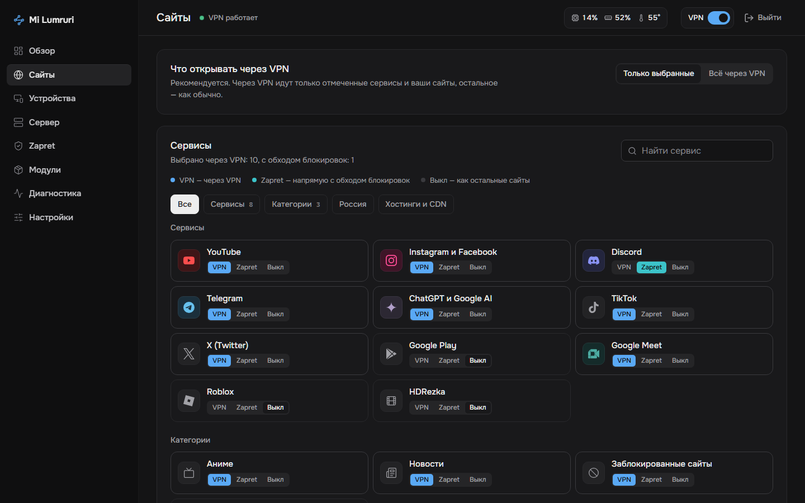
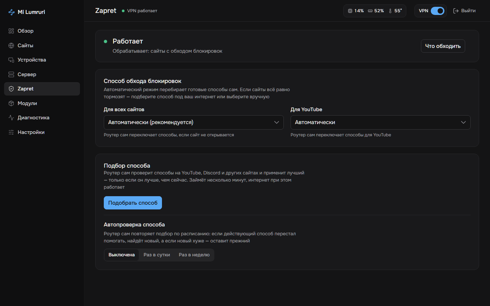

# Mi Lumruri

**Русский** · [English](README.en.md) · [简体中文](README.zh-CN.md)

Выборочный VPN и обход блокировок для Xiaomi BE7000 на штатной прошивке. Вставьте ссылку на сервер и отметьте сервисы: YouTube, Instagram и ChatGPT пойдут через VPN, Discord — напрямую с обходом блокировок Zapret, остальные сайты — как обычно. Встроен [TrustTunnel](https://github.com/TrustTunnel); VLESS, Hysteria2, Trojan, Shadowsocks и AmneziaWG добавляются модулями с флешки. Несколько серверов работают одновременно.


**Роутер:** Xiaomi BE7000 (RC06), прошивка 1.1.38. Прошивку менять не нужно. Пакет ставится по SSH во внутреннюю память (около 4,5 МБ) и работает на штатных iptables, ipset и dnsmasq.

**[Установить и настроить](docs/guide.md)** · [Обновить или откатить](docs/guide.md#обновление-и-откат) · [Ограничения](docs/guide.md#ограничения) · [Удалить](docs/guide.md#удаление) · [Собрать пакет](docs/build.md)

## Установка

Скачайте из [последнего релиза](https://github.com/NooBiToo/mi-lumruri/releases/latest) в одну папку три файла: `mi-lumruri-*.tar`, `SHA256SUMS` и `install.py`. В этой папке выполните:

```sh
python install.py 192.168.31.1
```

Нужны Python 3.8+, клиент OpenSSH и root-доступ к роутеру по SSH ([как его получить](docs/guide.md#доступ-по-ssh-перед-установкой)). Установщик сам спросит пароль root и задаст пароль панели. Панель откроется по адресу `https://192.168.31.1:8443/`.

Во внутренней памяти роутера мало места: около 20 МБ, из них около 9 МБ занимает прошивка. Если места хватает впритык, установщик ставит новую версию без хранения прежней и предупреждает, что откат будет недоступен.

## Что умеет

| | |
| --- | --- |
| **Серверы** | Вставьте ссылку, и поля заполнятся сами. **TrustTunnel** встроен: официальный клиент `trusttunnel_client` v1.3.0, HTTP/2 или HTTP/3, anti-DPI, профиль TLS, client_random, ссылка-подписка. **VLESS** (TCP, WebSocket, gRPC, Reality, xtls-rprx-vision), **Hysteria2**, **Trojan** и **Shadowsocks** — через модуль sing-box, подписки `https://` со списком серверов и выбором из него. **AmneziaWG** 1.x и 2.0 — через модуль amneziawg, по файлу `.conf`. До 16 серверов **одновременно**: у сервиса на «Сайтах» и у устройства можно выбрать свой. Запасной сервер TrustTunnel с переключением и возвратом, выбор сервера по меньшей задержке. Если сервер недоступен, сайты из списка ждут или открываются напрямую, на выбор. |
| **Сайты** | Каждый сервис — **VPN**, **Zapret** или **Выкл**. Готовые списки [itdoginfo/allow-domains](https://github.com/itdoginfo/allow-domains) с подсетями сервисов входят в пакет и обновляются сами: от каждых 6 часов до раза в неделю или только вручную. Свои сайты через VPN, свои сайты с обходом блокировок и исключения задаются отдельными списками. Есть режим «Всё через VPN, кроме исключений» и IPv6 через VPN. |
| **Zapret** | nfqws2 из zapret2 с готовыми стратегиями работает сразу. «Подобрать способ» проверяет стратегии на роутере и применяет лучшую, только если с ней сайты открываются лучше, чем без Zapret. Способ можно выбрать и вручную, для YouTube отдельно. Автопроверка способа по расписанию. |
| **Устройства** | Все устройства дома или только выбранные. Имена: ваши, объявленные в сети (iPhone, Chromecast, телевизоры, колонки), из DHCP или производитель по MAC. Отметка «скрытый MAC», подробности с типом подключения и трафиком. Отдельному устройству — «Весь интернет» через VPN и свой сервер. |
| **DNS** | Защищённый DNS (DoH или DoT) для остальных сайтов: Cloudflare, Google, AdGuard, NextDNS, Quad9 или свой сервер. Для сайтов через VPN — DNS внутри туннеля, по желанию зашифрованный. Свои DNS-записи: домен со всеми поддоменами указывает на адрес в домашней сети. Блокировка рекламы: HaGeZi Light, Normal или свой список. |
| **Обзор** | Плитки «Сейчас», обновляются раз в 5 секунд: скорость интернета и VPN с графиком, задержка до сервера, процессор по ядрам, память, температура по каждому датчику. Карточки маршрутов со скоростью канала по замеру и трафиком сейчас. Трафик за сутки и неделю по часам и по устройствам; с журналом на флешке — за месяц, 3 месяца и год (журнал хранится 1–24 месяца). Замер скорости и задержки с роутера. |
| **Модули** | Большие программы ставятся на флешку или во внутреннюю память, если хватает места: sing-box и AmneziaWG. Роутер скачивает модуль с GitHub, сверяет SHA-256 и подпись. Карточка «Накопители» показывает память и флешки; если флешку вынули, приходит уведомление, а когда её вернут, модуль запустится сам. |
| **Уведомления** | В Telegram: туннель упал или снова работает, сторож перезапустил клиент, переключение на запасной сервер, новая версия, обновление установлено или откатилось, подписка не обновилась, роутер загрузился. Сообщения ждут в очереди, если связи нет. |
| **Диагностика** | Проверка по кнопке: служба, автозапуск, прошивка, связь с сервером и версия клиента, выход в интернет через туннель, сторож туннеля, маршруты, DNS, Zapret и программы, которые падают по кругу. Проверка отдельного сайта: каким путём он идёт и открывается ли. Журналы и отчёт одной кнопкой, перезапуск службы. |
| **Обновление** | Из панели: роутер скачивает новый релиз с GitHub, проверяет SHA-256 и подпись, ставит его и 5 минут проверяет, что всё работает; если нет — сам возвращает прежнюю версию. Проверка новой версии раз в сутки или в неделю. Резервная копия настроек в файл, пароли — по желанию, зашифрованные паролем копии. |
| **Панель** | HTTPS и пароль, по желанию второй шаг — код из приложения (TOTP). Русский, английский и упрощённый китайский. Открывается по своему домену и через обратный прокси. Изменения сохраняются сами, панель удобна с телефона. |

<p>
  
  
</p>

<p>
  
  
</p>


<p>
  
  
</p>

## Как это устроено

1. dnsmasq заносит адреса доменов из списков в наборы ipset.
2. По этим наборам iptables помечает трафик выбранных устройств:
   - помеченный трафик уходит в TUN-интерфейс клиента своего сервера (TrustTunnel, sing-box или amneziawg-go; у каждого сервера свой туннель и своя метка);
   - сайты с обходом блокировок проходят через nfqws2;
   - остальное идёт напрямую.
3. Домены сайтов через VPN роутер разрешает DNS-сервером внутри туннеля, поэтому провайдер не видит и не подменяет ответы. Остальные домены идут через защищённый DNS программы `mi-tt-dns`, если он включён.
4. Контроллер на Rust сверяет правила с ядром и восстанавливает их после перезагрузки firewall.

Подробнее — в [архитектуре](ARCHITECTURE.md).

## Состояние

Пакет работает на BE7000 с прошивкой 1.1.38: туннель, выборочная маршрутизация, Zapret, защищённый DNS, несколько серверов одновременно, модуль sing-box и панель. Новые возможности сначала проверяются в сетевой лаборатории с компонентами штатной прошивки, затем на роутере. О найденных проблемах пишите в [Issues](https://github.com/NooBiToo/mi-lumruri/issues).

- Сайты из списков выбираются только по IPv4: устройствам с VPN или Zapret IPv6 наружу закрыт. Исключение — устройства, у которых через VPN идёт весь интернет, при включённом «IPv6 через VPN»: их IPv6 идёт через туннель, нужен IPv6 на VPN-сервере. У готовых DNS-серверов есть адреса IPv6, но они используются только как запасной путь.
- Сайты определяются по DNS: устройство должно спрашивать DNS у роутера. «Безопасный DNS» (DoH) в браузере обходит списки.
- Несколько серверов одновременно занимают биты метки плагина UU (игрового ускорителя) или, если он включён, резервного WAN. Если включены оба, работает один сервер. Запасной сервер включается вместо основного, переключение занимает до 2 минут.
- Серверы VLESS, Hysteria2, Trojan и Shadowsocks работают через модуль sing-box на флешке или во внутренней памяти; серверы AmneziaWG — через модуль amneziawg.
- DoT работает не везде: многие провайдеры закрывают порт 853.

Полный список — в [руководстве](docs/guide.md#ограничения).

## Разработчикам

Раньше проект назывался mi-trusttunnel. С версии 0.5.0 пакет и папки на роутере называются `mi-lumruri` (`/data/mi-lumruri`, `/tmp/mi-lumruri`). Установка новой версии поверх 0.4 переносит `/data/mi-trusttunnel` в `/data/mi-lumruri` вместе с настройками, паролями и ключами, а на старом месте оставляет ссылку: откат на 0.4 и старые команды продолжают работать. Программы внутри пакета по-прежнему называются `mi-tt-*`.

- Контроллер, административная утилита и DNS-прокси написаны на Rust и собраны в одну программу `mi-tt`.
- Панель — Vue 3, TypeScript и PrimeVue.
- На роутере работают штатные nginx, uhttpd, dnsmasq, iptables и ipset. Node.js нужен только на компьютере сборки.
- Изменения проверяются в сетевой лаборатории с компонентами штатной прошивки.

[Сборка и тесты](docs/build.md) · [Архитектура](ARCHITECTURE.md) · [Журнал этапов](VERTICAL-SLICE.md)

Похожий проект для OpenWrt: [TrustTunnelOpenWrt](https://github.com/NooBiToo/TrustTunnelOpenWrt). Лицензии компонентов — в [NOTICE](NOTICE).
