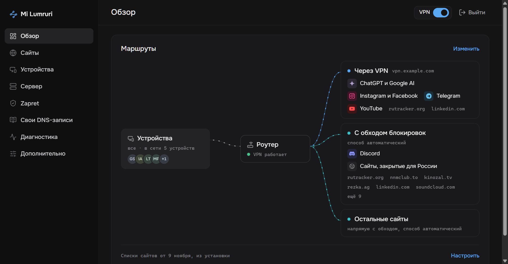
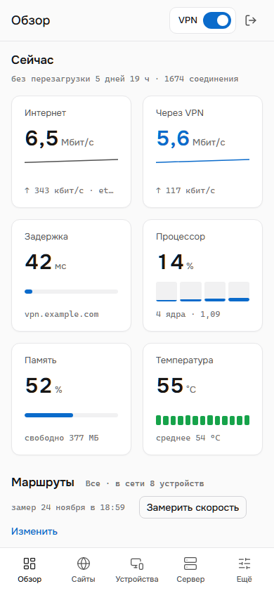
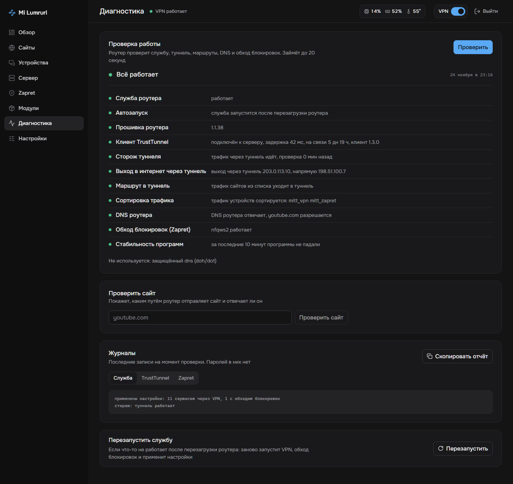

# Mi Lumruri

Выборочный VPN и обход блокировок для Xiaomi BE7000 на штатной прошивке. Вставьте ссылку на сервер [TrustTunnel](https://github.com/TrustTunnel), отметьте сервисы — YouTube, Instagram, ChatGPT пойдут через VPN, Discord — напрямую с обходом блокировок Zapret, всё остальное — как обычно.



**Роутер:** Xiaomi BE7000 (RC06), прошивка 1.1.38. Прошивку менять не нужно: пакет ставится по SSH во внутреннюю память (около 3,8 МБ) и работает на штатных iptables, ipset и dnsmasq.

**[Установить и настроить](docs/guide.md)** · [Обновить или откатить](docs/guide.md#обновление-и-откат) · [Ограничения](docs/guide.md#ограничения) · [Удалить](docs/guide.md#удаление) · [Собрать пакет](docs/build.md)

## Установка

Скачайте из [последнего релиза](https://github.com/NooBiToo/mi-lumruri/releases/latest) три файла — `mi-trusttunnel-*.tar`, `SHA256SUMS` и `install.py` — в одну папку и выполните в ней:

```sh
python install.py 192.168.31.1
```

Нужны Python 3.8+, клиент OpenSSH и root-доступ к роутеру по SSH ([как его получить](docs/guide.md#доступ-по-ssh-перед-установкой)). Установщик сам спросит пароль root и задаст пароль панели. Панель: `https://192.168.31.1:8443/`.

## Что умеет

| | |
| --- | --- |
| **Сервер** | Ссылка `tt://` или файл `client.toml` — поля заполняются сами. Адрес сервера — IP или домен. Официальный клиент `trusttunnel_client` v1.3.0: HTTP/2 или HTTP/3, anti-DPI, свой сертификат, профиль TLS и client_random (префикс или ключ сервера 1.3). Если сервер недоступен, сайты из списка ждут или открываются напрямую — на выбор. |
| **Сайты** | Каждый сервис — **VPN**, **Zapret** или **Выкл**. Готовые списки [itdoginfo/allow-domains](https://github.com/itdoginfo/allow-domains) с подсетями сервисов входят в пакет и обновляются сами — от каждых 6 часов до раза в неделю или только вручную. Свои сайты через VPN, свои сайты с обходом блокировок и исключения — отдельными списками, по сайту в строке. Режим «Всё через VPN, кроме исключений». |
| **Zapret** | nfqws2 из zapret2 с готовыми стратегиями работает сразу. «Подобрать способ» проверяет стратегии на роутере и применяет лучшую, только если она лучше, чем без Zapret; способ можно выбрать и вручную, для YouTube — отдельно. Автопроверка способа по расписанию. Всё — на отдельной странице «Zapret». |
| **Устройства** | Все устройства дома или только выбранные — по списку подключённых. |
| **DNS** | Защищённый DNS (DoH/DoT) для остальных сайтов — Cloudflare, Google, AdGuard, NextDNS, Quad9 (DoT) или свой, с запасным путём через провайдера. Сервер для сайтов через VPN на выбор: Cloudflare, Quad9, Google, AdGuard, NextDNS или свой; запросы к нему идут через туннель. Отдельная страница «Свои DNS-записи»: домен со всеми поддоменами — на адрес в домашней сети, например на сервер с Traefik. Блокировка рекламы через DNS роутера — HaGeZi Light, Normal или свой список, обновляется сама. |
| **Диагностика** | Проверка по кнопке: служба, связь с сервером, выход в интернет через туннель, маршруты, DNS, Zapret и программы, которые падают по кругу. Проверка отдельного сайта — каким путём он идёт и открывается ли. Журналы и отчёт одной кнопкой, перезапуск службы. |
| **Вход** | HTTPS и пароль, по желанию второй шаг — код из приложения (TOTP). |

Изменения сохраняются сами. Панель работает и с телефона.

<p>
  
  
</p>



## Как это устроено

dnsmasq заносит адреса доменов из списков в наборы ipset. По ним iptables помечает трафик выбранных устройств: помеченное уходит в TUN-интерфейс клиента TrustTunnel, сайты с обходом блокировок проходят через nfqws2, остальное — напрямую. Домены сайтов через VPN разрешаются DNS-сервером внутри туннеля, поэтому провайдер не видит и не подменяет ответы. Контроллер на Rust сверяет правила с ядром и восстанавливает их после перезагрузки firewall. Подробнее — в [архитектуре](ARCHITECTURE.md).

## Состояние

Пакет работает на BE7000 с прошивкой 1.1.38: туннель, выборочная маршрутизация, Zapret и панель. Проверка на устройстве продолжается — о найденных проблемах пишите в [Issues](https://github.com/NooBiToo/mi-lumruri/issues).

- Маршрутизируется только IPv4: устройствам с VPN или Zapret IPv6 наружу закрыт.
- Сайты определяются по DNS: устройство должно спрашивать DNS у роутера. «Безопасный DNS» (DoH) в браузере обходит списки.
- Один сервер TrustTunnel.

Полный список — в [руководстве](docs/guide.md#ограничения).

## Разработчикам

Раньше проект назывался mi-trusttunnel. Это имя осталось у файлов пакета, программ и папок на роутере (`/data/mi-trusttunnel`), поэтому прежние установки обновляются без переустановки.

Контроллер и административная утилита — Rust, панель — Vue 3, TypeScript и PrimeVue. На роутере используются штатные nginx, uhttpd, dnsmasq, iptables и ipset; Node.js нужен только на компьютере сборки. Изменения проверяются в сетевой лаборатории с компонентами штатной прошивки. [Сборка и тесты](docs/build.md) · [Архитектура](ARCHITECTURE.md) · [Журнал этапов](VERTICAL-SLICE.md)

Похожий проект для OpenWrt: [TrustTunnelOpenWrt](https://github.com/NooBiToo/TrustTunnelOpenWrt). Лицензии компонентов — в [NOTICE](NOTICE).
