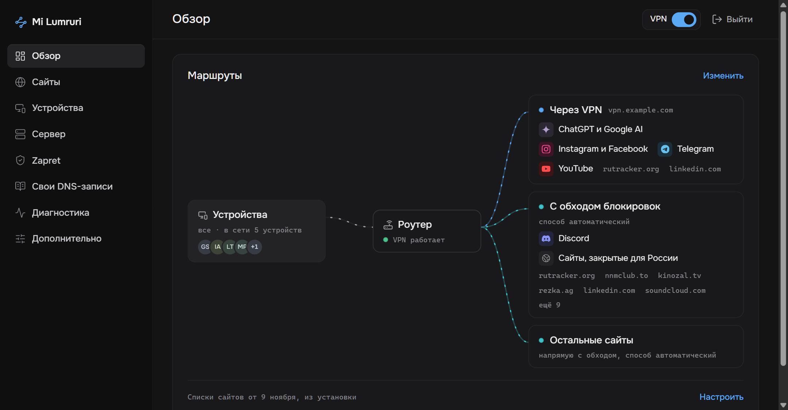
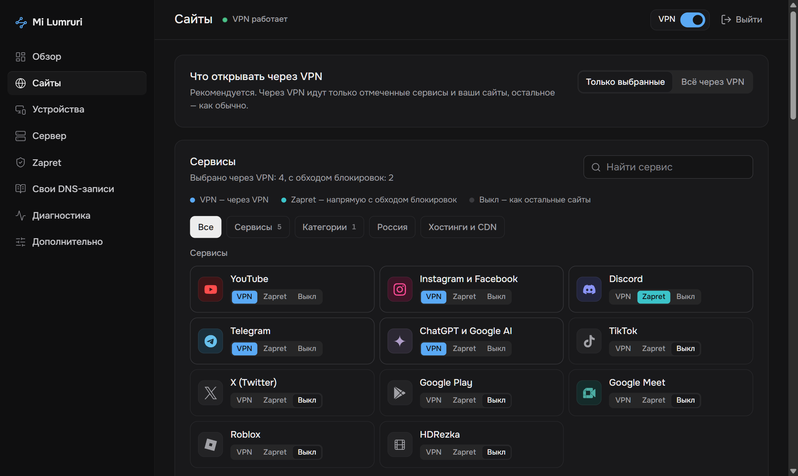
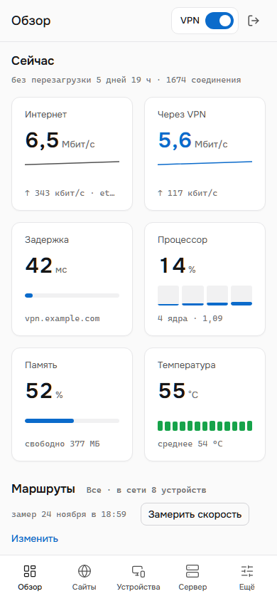
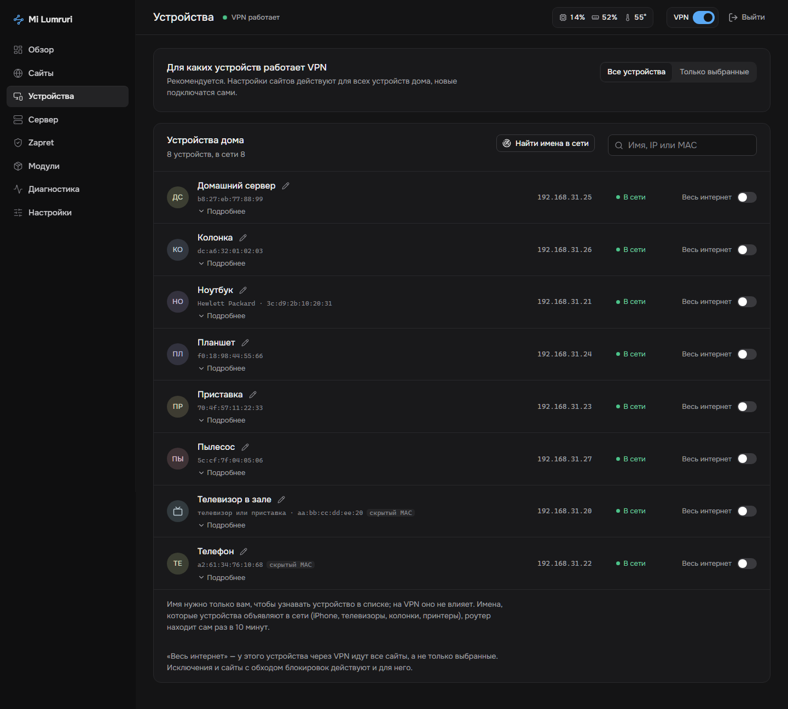
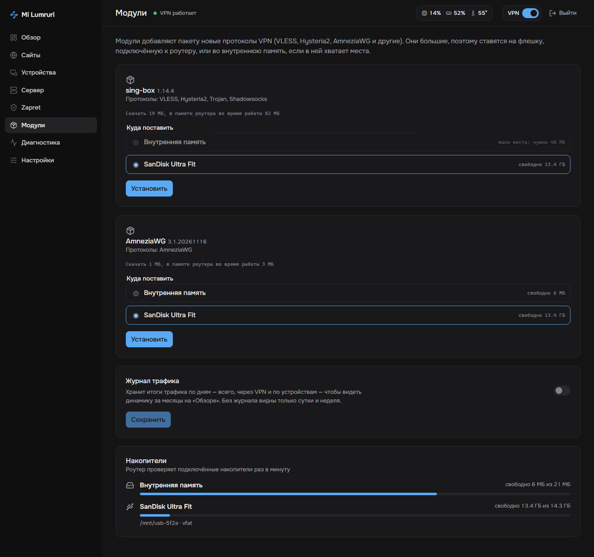
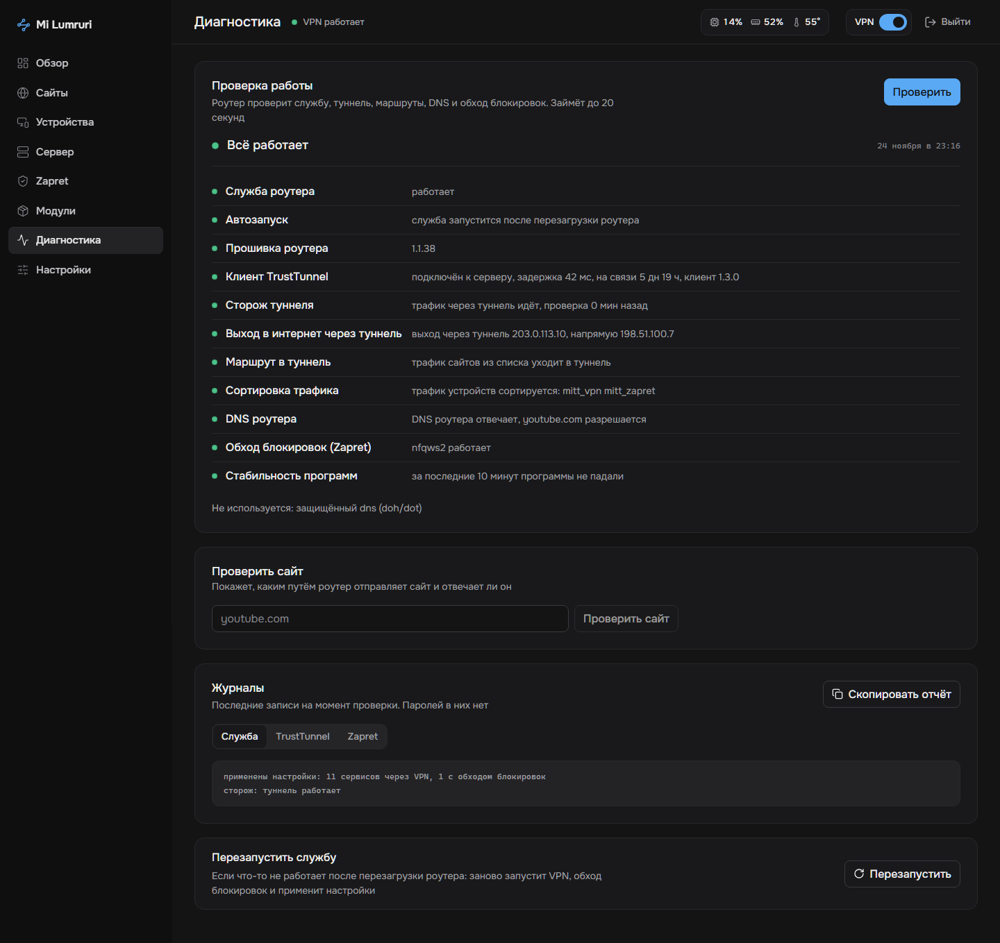
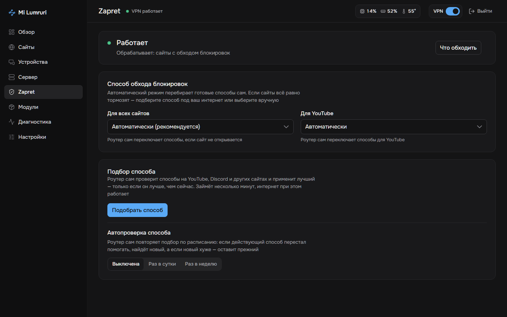
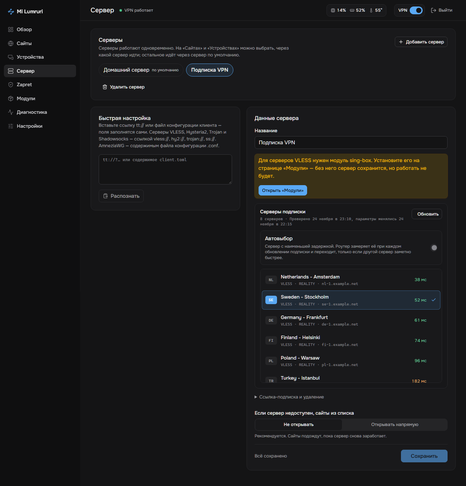

# Mi Lumruri

[Русский](README.md) · [English](README.en.md) · **简体中文**

为原厂固件的小米 BE7000 提供分流 VPN 和 DPI 绕过。粘贴服务器链接，然后勾选服务：YouTube、Instagram 和 ChatGPT 走 VPN，Discord 直连并通过 Zapret 绕过封锁，其他网站照常访问。内置 [TrustTunnel](https://github.com/TrustTunnel)；VLESS、Hysteria2、Trojan、Shadowsocks 和 AmneziaWG 以 U 盘上的模块提供。多个服务器可同时运行。



**路由器：** 小米 BE7000（RC06），固件 1.1.38。无需刷机：软件包通过 SSH 安装到内部存储（约 4.5 MB），使用原厂的 iptables、ipset 和 dnsmasq 运行。

**[安装与设置](docs/guide.zh-CN.md)** · [更新或回滚](docs/guide.zh-CN.md#更新与回滚) · [限制](docs/guide.zh-CN.md#限制) · [卸载](docs/guide.zh-CN.md#卸载) · [构建软件包](docs/build.md)（俄语）

## 安装

从[最新发布版](https://github.com/NooBiToo/mi-lumruri/releases/latest)下载三个文件到同一个文件夹：`mi-lumruri-*.tar`、`SHA256SUMS` 和 `install.py`。在该文件夹中运行：

```sh
python install.py 192.168.31.1
```

需要 Python 3.8+、OpenSSH 客户端，以及路由器的 root SSH 权限（[获取方法](docs/guide.zh-CN.md#安装前开启-ssh-访问)）。安装程序会询问 root 密码并设置面板密码。面板地址：`https://192.168.31.1:8443/`。

路由器内部存储空间很小：约 20 MB，其中固件占用约 9 MB。空间紧张时，安装程序会安装新版本但不保留旧版本，并提示将无法回滚。

## 功能

| | |
| --- | --- |
| **服务器** | 粘贴链接，字段自动填写。**TrustTunnel** 内置：官方客户端 `trusttunnel_client` v1.3.0，HTTP/2 或 HTTP/3、anti-DPI、TLS 配置文件、client_random、订阅链接。**VLESS**（TCP、WebSocket、gRPC、Reality、xtls-rprx-vision）、**Hysteria2**、**Trojan** 和 **Shadowsocks** 通过 sing-box 模块运行，支持 `https://` 订阅，可从服务器列表中选择。**AmneziaWG** 1.x 和 2.0 通过 amneziawg 模块运行，使用 `.conf` 文件。最多 16 个服务器**同时**运行：「网站」中的服务和设备都可以选择各自的服务器。订阅服务器以列表显示，附带各服务器延迟，可自动选择最快的服务器。TrustTunnel 备用服务器支持切换和回切，并可按更低延迟选择服务器。服务器不可用时，列表中的网站可选择等待或直连。 |
| **网站** | 每个服务可设为 **VPN**、**Zapret** 或 **关闭**。软件包自带 [itdoginfo/allow-domains](https://github.com/itdoginfo/allow-domains) 列表及服务网段，并自动更新：从每 6 小时到每周一次，或仅手动。自定义 VPN 网站、绕过封锁的网站和例外分别以列表设置。支持「全部走 VPN，例外除外」模式和 IPv6 走 VPN。 |
| **Zapret** | 内置 zapret2 的 nfqws2 和现成策略，开箱即用。「选择方式」在路由器上测试策略，仅当效果优于不使用 Zapret 时才应用最佳策略。也可手动选择方式，YouTube 可单独设置。支持定期自动检查方式。 |
| **设备** | 全部家庭设备或仅所选设备。名称：您设置的名称、设备在网络中广播的名称（iPhone、Chromecast、电视、音箱）、DHCP 名称或按 MAC 识别的厂商。「隐藏 MAC」标记，详情中显示连接方式和流量。单个设备可设为「全部互联网」走 VPN 并使用自己的服务器。 |
| **DNS** | 为其他网站提供安全 DNS（DoH 或 DoT）：Cloudflare、Google、AdGuard、NextDNS、Quad9 或自定义服务器。走 VPN 的网站使用隧道内的 DNS，可选加密。自定义 DNS 记录：域名及其所有子域名指向家庭网络中的地址。广告拦截：HaGeZi Light、Normal 或自定义列表。 |
| **概览** | 「当前」卡片每 5 秒刷新：互联网和 VPN 速度及图表、到服务器的延迟、各核心处理器负载、内存、每个传感器的温度。路由卡片显示测速得到的通道速度和当前流量。按小时和按设备统计一天和一周的流量；启用 U 盘上的日志后，还可查看月、3 个月和年（日志保留 1–24 个月）。可从路由器测速和测延迟。 |
| **模块** | 大型程序安装到 U 盘，空间足够时也可安装到内部存储：sing-box、AmneziaWG 以及 **Telegram 经 WebSocket**——无需 VPN 服务器、无需在应用中设置代理，经网页版入口连接 Telegram；WebSocket 不可用时可选经 VPN 或直连。路由器从 GitHub 下载模块并校验 SHA-256 和签名。「存储设备」卡片显示内部存储和 U 盘；U 盘被拔出时会收到通知，重新插入后模块会自动启动。 |
| **通知** | Telegram：隧道断开或恢复、看门狗重启了客户端、切换到备用服务器、有新版本、更新已安装或已回滚、订阅更新失败、路由器启动。没有网络时消息在队列中等待。 |
| **诊断** | 一键检查：服务、自启动、固件、与服务器的连接和客户端版本、经隧道访问互联网、隧道看门狗、路由、DNS、Zapret 以及反复崩溃的程序。单个网站检查：走哪条路径、能否打开。一键获取日志和报告，重启服务。 |
| **更新** | 在面板中更新：路由器从 GitHub 下载新版本，校验 SHA-256 和签名后安装，并在 5 分钟内确认一切正常；否则自动回滚到之前的版本。每天或每周检查新版本。设置可备份到文件，服务器密码可选，并用备份密码加密。 |
| **面板** | HTTPS 和密码，可选第二步：应用验证码（TOTP）。支持俄语、英语和简体中文。可通过自己的域名和反向代理访问。修改自动保存，手机上也方便使用。 |

<p>
  
  
</p>

<p>
  
  
</p>



<p>
  
  
</p>

## 工作原理

1. dnsmasq 把列表中域名的地址加入 ipset 集合。
2. iptables 根据这些集合标记所选设备的流量：
   - 被标记的流量进入其服务器客户端的 TUN 接口（TrustTunnel、sing-box 或 amneziawg-go；每个服务器有各自的隧道和标记）；
   - 绕过封锁的网站经过 nfqws2；
   - 其余流量直连。
3. 路由器用隧道内的 DNS 服务器解析 VPN 网站的域名，运营商无法看到或篡改应答。启用安全 DNS 后，其他域名通过 `mi-tt-dns` 程序的安全 DNS 解析。
4. Rust 编写的控制器会让规则与内核保持一致，并在防火墙重载后恢复规则。

详见[架构文档](ARCHITECTURE.md)（俄语）。

## 状态

软件包已在固件 1.1.38 的 BE7000 上运行：隧道、分流、Zapret、安全 DNS、多个服务器同时运行、sing-box 模块和面板。新功能先在使用原厂固件组件的网络实验环境中验证，再在路由器上测试。发现问题请提交到 [Issues](https://github.com/NooBiToo/mi-lumruri/issues)。

- 列表中的网站只按 IPv4 匹配：设置了 VPN 或 Zapret 规则的设备无法对外使用 IPv6。例外是开启「IPv6 走 VPN」时全部流量走 VPN 的设备：它们的 IPv6 经隧道传输，需要 VPN 服务器支持 IPv6。预设 DNS 服务器带有 IPv6 地址，但仅作为备用路径。
- 网站按 DNS 识别：设备必须使用路由器作为 DNS 服务器。浏览器中的「安全 DNS」（DoH）会绕过列表。
- 同时使用多个服务器会占用 UU 插件（游戏加速器）的标记位；如果 UU 已启用，则占用备用 WAN 的标记位。两者都启用时只有一个服务器工作。备用服务器替代主服务器启用，切换最多需要 2 分钟。
- VLESS、Hysteria2、Trojan 和 Shadowsocks 服务器通过 U 盘或内部存储中的 sing-box 模块工作；AmneziaWG 服务器通过 amneziawg 模块工作。
- DoT 并非处处可用：许多运营商封锁了 853 端口。

完整列表见[指南](docs/guide.zh-CN.md#限制)。

## 开发者

项目原名 mi-trusttunnel。自 0.5.0 版本起，安装包和路由器上的文件夹改名为 `mi-lumruri`（`/data/mi-lumruri`、`/tmp/mi-lumruri`）。在 0.4 之上安装新版本时，会把 `/data/mi-trusttunnel` 连同设置、密码和密钥一起移动到 `/data/mi-lumruri`，并在原位置留下链接，因此回滚到 0.4 和旧命令仍然可用。安装包内的程序仍名为 `mi-tt-*`。

- 控制器、管理工具和 DNS 代理用 Rust 编写，并合并为一个程序 `mi-tt`。
- 面板使用 Vue 3、TypeScript 和 PrimeVue。
- 路由器上使用原厂的 nginx、uhttpd、dnsmasq、iptables 和 ipset。只有构建机需要 Node.js。
- 改动在由原厂固件组件搭建的网络实验环境中测试。

[构建与测试](docs/build.md) · [架构](ARCHITECTURE.md) · [阶段日志](VERTICAL-SLICE.md)（均为俄语）

OpenWrt 上的类似项目：[TrustTunnelOpenWrt](https://github.com/NooBiToo/TrustTunnelOpenWrt)。各组件的许可证见 [NOTICE](NOTICE)。
